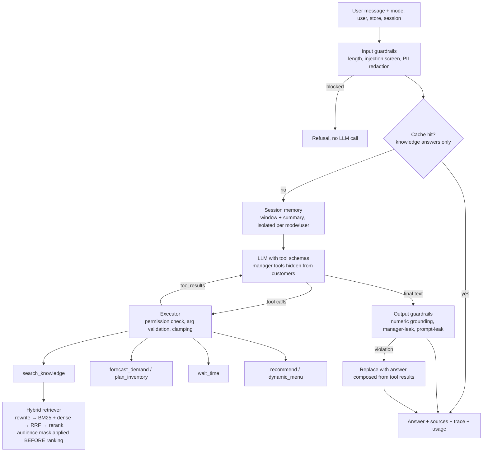
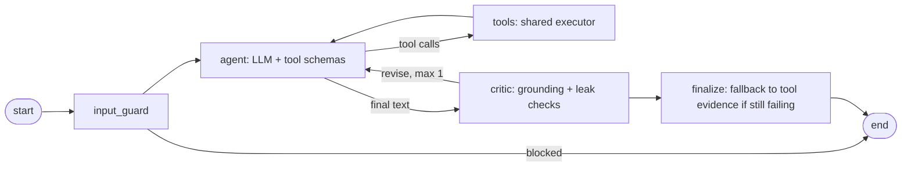

# QSR GenAI Assistant

A tool-calling GenAI assistant for a (fictional) quick-service-restaurant app. An LLM agent answers customer and store-manager questions by **calling tools**: a **hybrid RAG** search over 113 documents and three **ML models** (demand forecast + inventory plan, wait-time, recommender). It ships with **guardrails, session memory, streaming, tracing, cost tracking and an evaluation harness** that gates CI, plus a **LangGraph** version of the agent (with a critic loop), an **MCP server**, **structured output**, **image input**, **Qdrant/FAISS** vector stores, a **GraphRAG-lite** experiment, **fine-tuning scripts** (embedder + QLoRA), a **BEIR benchmark runner** and **deployment configs**.

> Everything in the bundled corpus is synthetic. The restaurant, menu, stores, policies and data are invented; nothing is derived from a real company.

## Verification status: what has actually been run

Read this first. It separates what is measured from what is provided but not yet run.

| Area | Status |
|---|---|
| 227 tests, ruff, offline evaluation gate | **Run and passing** (`pip install -e ".[dev,llm,graph,mcp,qdrant,faiss]"`) |
| Real Anthropic/OpenAI SDKs against a local fake server (tool calls, streaming, image blocks) | **Run and passing**; not run against the live APIs |
| LangGraph agent: parity with the hand-rolled agent, critic revise loop, permission denial | **Run and passing** (offline + scripted LLM) |
| MCP server over real stdio with the official MCP client | **Run and passing** |
| FAISS and Qdrant (in-memory) stores agree with the NumPy reference; retriever runs on Qdrant | **Run and passing** |
| Retrieval ablation incl. GraphRAG-lite and 20 multi-hop questions | **Run**, results below |
| **Real-LLM evaluation** (faithfulness, answer quality, model tool-selection, cost) | **Not run: needs your API key.** One command or one manual GitHub Action, see [Real-LLM evaluation](#real-llm-evaluation) |
| **Neural embeddings + cross-encoder rows** in the ablation | **Not run:** needs `sentence-transformers` and a model download. The wrapper (query/passage prefixes, query-side encoding) is unit-tested with a fake model |
| **BEIR benchmark** (public corpus with human labels) | **Not run:** needs internet. Loader and metrics are tested on a fixture; `python scripts/run_beir.py` runs it |
| **Embedder fine-tune** and **QLoRA fine-tune** | **Not run:** need model downloads (QLoRA needs a GPU). Data builders, document-level split and scorer are tested |
| Cloud deployment | **Not deployed:** configs provided in [`docs/DEPLOY.md`](docs/DEPLOY.md) |

Empty cells are left empty on purpose rather than filled with invented numbers.

## What this project demonstrates

| GenAI engineering skill | Where |
|---|---|
| Native tool / function calling with a bounded agent loop (Anthropic + OpenAI) | `agent/agent.py`, `llm/` |
| **LangGraph** state machine with a **critic/verifier** node and revise loop, parity-tested against the hand-rolled agent | `agent/graph.py` |
| **MCP server** exposing the tools to any MCP client, identity fixed by the operator | `mcp_server/server.py` |
| Agentic RAG: the model decides when to retrieve and writes the search query | `search_knowledge` tool |
| Hybrid retrieval (BM25 + dense, RRF), query rewriting, reranking, metadata + access filters | `rag/` |
| **Vector stores**: NumPy, **FAISS**, **Qdrant** (in-process or server) | `rag/vectorstore.py` |
| **Neural embeddings** (MiniLM / bge / e5 with automatic prefixes) and **cross-encoder reranking** | `rag/embeddings.py`, `rag/reranker.py` |
| **GraphRAG-lite**: entity-linked chunk graph that reserves one result slot for a neighbour, measured in the ablation | `rag/graph.py` |
| Retrieval ablation with confidence intervals; multi-hop set; abstention calibration | `eval/retrieval_eval.py`, `eval/abstain.py` |
| **Public-benchmark evaluation** (BEIR format: nDCG@10, MRR, recall) | `eval/beir.py`, `scripts/run_beir.py` |
| **Structured output**: Pydantic schema, validation, repair loop, safe fallback | `llm/structured.py`, `POST /extract/ticket` |
| **Multimodal input**: validated image, vision description sanitised against injection, then the normal agent loop | `llm/vision.py`, `POST /chat/image` |
| **Fine-tuning**: embedder (MNRL + hard negatives, document-level split) and **QLoRA** for JSON extraction | `training/` |
| RAG answer evaluation: correctness, faithfulness (LLM-as-judge or lexical proxy) | `eval/judge.py`, `eval/evaluate.py` |
| Guardrails: injection screen, PII redaction, numeric grounding, leak detection, indirect-injection sanitising | `guardrails/` |
| Security by construction: permissions enforced in code, identity never taken from model arguments | `agent/tools.py` |
| Streaming (SSE), session memory with isolation, response cache, **rate limiting** | `api/main.py`, `agent/memory.py` |
| Observability: traces/spans, metrics, token + cost tracking, optional Langfuse | `observability/` |
| ML models as tools, with honest baselines | `ml/` |
| Engineering: 227 tests, CI evaluation gate, manual real-LLM eval workflow, Docker, Render/Cloud Run/HF configs | `tests/`, `.github/`, `Dockerfile`, `render.yaml` |

## Architecture



Key design decisions:

* **The executor, not the model, enforces permissions.** Customers are never shown manager tools, and if a model asks for one anyway (jailbreak, hallucination) the executor denies it. `audience`, `mode` and `user_id` come from the authenticated request and cannot be set via tool arguments. Sessions are namespaced by `(mode, user_id, session_id)` so manager context can never be replayed into a customer request.
* **Access control is a mask before ranking**, so restricted chunks cannot influence scores or confidence.
* **Graceful degradation**: if a provider call fails, the request falls back to the offline client instead of erroring.
* **Offline client = same protocol, no keys.** `OfflineClient` speaks the identical tool-calling interface (rules pick tools, answers are composed extractively), so the entire loop, guardrails, API and CI run without network access.

### The same agent in LangGraph

`agent/graph.py` re-implements the loop as a graph. The `critic` node re-runs the output guardrails (numeric grounding, manager-info leak, prompt leak). On a violation it sends the draft back **once** with feedback; if the revision still fails, `finalize` falls back to an answer composed from tool results.



**Hand-rolled vs LangGraph, honestly.** Both share guardrails, tools, memory and pricing, and `tests/test_graph_agent.py` checks they give the same answers and tool calls. The hand-rolled `Agent` has streaming, caching and tracing; the graph version has the explicit critic edge, a visualisable topology (`GraphAgent.mermaid()`) and is the form most teams will recognise. The graph version is non-streaming and has no cache or tracing yet.

## Quick start

```bash
pip install -e ".[dev]"              # offline mode, no API key needed
make test
make eval                            # offline evaluation + regression gate
make api                             # http://localhost:8000/docs
make ui                              # Streamlit chat, dashboard and traces
```

Optional extras: `.[llm]` (Anthropic/OpenAI SDKs), `.[graph]` (LangGraph), `.[mcp]`, `.[qdrant]`, `.[faiss]`, `.[vector]` (sentence-transformers), `.[finetune]`, `.[all]`.

With a real model:

```bash
pip install -e ".[dev,llm]"
export ANTHROPIC_API_KEY=...         # or OPENAI_API_KEY
# optional: export LLM_MODEL=<model id>   (default: claude-sonnet-5-5 / gpt-4o-mini; verify against your account)
make ui
```

With neural retrieval and a vector DB:

```bash
pip install -e ".[vector,qdrant]"
export EMBEDDING_BACKEND=sentence-transformers EMBEDDING_MODEL=BAAI/bge-small-en-v1.5
export RERANKER=cross-encoder VECTOR_STORE=qdrant        # QDRANT_URL=... for a server
make ablation                                            # adds MiniLM / bge / cross-encoder rows
```

Your own documents: drop `.md`/`.txt` files (optionally with front matter) in `data/knowledge/`, or `python scripts/ingest.py --src ./docs --audience all --type faq` (PDFs need `pip install -e ".[pdf]"`).

### Use it from Claude Desktop / any MCP client

```json
{"mcpServers": {"qsr-assistant": {"command": "python", "args": ["-m", "qsr_assistant.mcp_server.server"],
  "env": {"MCP_MODE": "customer"}}}}
```

`MCP_MODE=manager` also registers `forecast_demand` and `plan_inventory`; in customer mode those tools do not exist.

## Evaluation

Run `make eval` (offline) or `make eval-llm` (real model). Reports land in `reports/`; the offline run is committed in [`docs/results/`](docs/results).

### What the offline run measures, and what it does not

The offline backend replaces the LLM with a rule-based stand-in, so **it exercises retrieval, tools, permissions, guardrails, memory and the API, but not LLM answer quality**. Numbers that depend on a model (faithfulness, answer quality, tool-selection by a model, prompt-leak resistance, cost) are only meaningful in a real-LLM run, which has **not** been run in this repository's history, so those cells are empty.

| Metric (181 questions unless noted) | Offline | Real LLM |
|---|---|---|
| Retrieval Hit@3 / MRR@5 (default config) | 85.6% / 0.742 | same (retrieval is model-independent) |
| Answer contains reference fact | 58.0% (extractive, top-1 chunk only) | _not run_ |
| Faithfulness | 100% (lexical judge on extractive answers; trivially high) | _not run_ |
| Tool-selection exact match (25 cases) | 100% (rules written alongside the cases: circular) | _not run_ |
| Manager tools executed for customers | 0 of 2 requests (executor-enforced) | _not run_ |
| Valid questions wrongly declined | 11.1% | _not run_ |
| Out-of-scope questions declined (16) | 43.8% | _not run_ |
| Plain attacks blocked at input (25) / benign false positives (20) | 100% / 0% (patterns written alongside the set) | n/a (input stage) |
| Evasive attacks blocked at input (8) / leaked manager info | 0% / 0 of 8 | _not run_ |
| Plain manager-info requests that leaked (8) | 0 | _not run_ |
| Follow-up questions correct, memory on / off (6 turns) | 100% / 66.7% | _not run_ |
| ML hold-out | demand MAPE 5.2% vs 9.5% seasonal-naive; wait MAE 0.57 vs 1.94 min | same |

### Real-LLM evaluation

Either run it locally:

```bash
pip install -e ".[dev,llm]" && export ANTHROPIC_API_KEY=...   # or OPENAI_API_KEY
make eval-llm                         # a few dollars at most; writes reports/eval_<provider>.json
python scripts/make_resume_bullets.py # fills docs/RESUME_BULLETS.md from the measured numbers
```

or trigger **Actions > eval-llm > Run workflow** after adding the key as a repository secret. The bullet generator refuses to read an offline report, and every number in its output comes from the JSON. Set `JUDGE_BACKEND` to a different provider than the one under test so the model is not grading itself.

### Retrieval ablation (181 questions, 113 documents, 95% bootstrap CIs on Hit@3)

| Configuration | Hit@1 | Hit@3 | Hit@5 | MRR@5 | Hit@3 95% CI |
|---|---|---|---|---|---|
| BM25 | 56.9 | 79.0 | 81.2 | 0.675 | 72.9-84.5 |
| Dense: TF-IDF cosine | 55.2 | 77.3 | 81.2 | 0.661 | 71.3-82.9 |
| Dense: LSA (SVD) | 35.9 | 60.8 | 70.7 | 0.488 | 53.0-67.4 |
| Hybrid: BM25 + LSA (RRF) | 46.4 | 69.1 | 73.5 | 0.576 | 62.4-75.7 |
| Hybrid: BM25 + TF-IDF (RRF) | 55.2 | 77.9 | 81.2 | 0.666 | 71.8-83.4 |
| BM25 + query rewrite | 61.9 | 86.2 | 90.6 | 0.744 | 81.2-91.2 |
| BM25 + rewrite + rerank | 62.4 | 85.6 | 90.6 | 0.749 | 80.7-90.6 |
| Hybrid (BM25 + TF-IDF) + rewrite | 61.3 | 85.6 | 90.6 | 0.740 | 80.6-90.6 |
| **Hybrid (BM25 + TF-IDF) + rewrite + rerank (default)** | 61.3 | 85.6 | 90.6 | 0.742 | 80.7-90.6 |
| Same, section-level chunks | 60.8 | 84.5 | 89.0 | 0.719 | 79.0-89.5 |
| Default + graph-neighbour slot (GraphRAG-lite) | 61.3 | 85.6 | 89.5 | 0.739 | 80.7-90.6 |
| MiniLM / bge-small dense and hybrid, cross-encoder rerank | _not run (needs model download; rows appear automatically in `make ablation` once `.[vector]` is installed)_ | | | | |

**Multi-hop (20 two-document questions, top-4 results)**

| Configuration | Both gold docs in top-4 | Doc recall@4 | 95% CI (both) |
|---|---|---|---|
| Default (hybrid + rewrite + rerank) | 85.0% | 90.0% | 69.9-100.0 |
| Default + graph-neighbour slot | 85.0% | 87.5% | 69.9-100.0 |

Full tables and per-document-type breakdown: [`docs/results/ablation.md`](docs/results/ablation.md).

**How to read this honestly:**

* **Query rewriting is the one clear win (about +7 pts Hit@3).** But the thesaurus behind it is hand-written, and I wrote the eval questions' paraphrases knowing the vocabulary gaps (chips/fries, soda/cola), so the gain overstates how it generalises.
* **Hybrid and reranking do not beat BM25 here.** Differences among the top rows sit well inside the confidence intervals. With lexical-only "dense" legs on a 113-document corpus there is little for fusion or a hand-weighted reranker to add. Hybrid + rerank stays the default because it is the slot neural embeddings and a cross-encoder plug into, **not** because it won. The next experiment is `make ablation` with `sentence-transformers` installed.
* **GraphRAG-lite did not help.** Reserving the 4th result for a graph neighbour cost about one point of Hit@5 and a little multi-hop recall (90.0 to 87.5, within noise on 20 questions). The documents here are short and mostly self-contained, and BM25 already surfaces both documents when a question names both topics. I kept the module because it is an inspectable baseline and the negative result is informative; it is off by default (`GRAPH_EXPAND=0`). A real test of graph methods needs a corpus with genuine cross-document entities.
* **The multi-hop set is small and author-written** (20 questions; the CI spans 70-100%), so it cannot separate the configurations. Treat it as a smoke test.
* **Remaining failures are mostly vocabulary mismatch** ("freezing" vs "crashes", "wipe my information" vs "delete my data"), which neural embeddings are meant to fix. That is a hypothesis until the neural rows are run.
* **Abstention from retrieval scores is weak.** Lexical confidence separates in-scope from out-of-scope poorly, so the threshold (0.23, chosen on a dev split under a "keep at least 88% of valid questions" constraint) only declines about half of out-of-scope questions on the held-out split. The LLM is also instructed to decline irrelevant context; the real-LLM run measures how well that works.
* The corpus and the questions were both written by me and are small. Treat all numbers as a regression baseline and a demonstration of method, not as benchmark results. For text I did not write, run the BEIR benchmark below.

### Public benchmark (BEIR)

```bash
python scripts/run_beir.py --dataset scifact            # BM25 / TF-IDF / hybrid, ~3 MB download
python scripts/run_beir.py --dataset scifact --neural   # adds MiniLM + cross-encoder (needs .[vector])
```

Writes `docs/results/beir-<dataset>.md`. SciFact, FiQA and NFCorpus work out of the box. **Not run yet** (no internet in the environment this was built in); the loader, nDCG@10 and the run loop are tested on a fixture. Published BM25 nDCG@10 on SciFact is a useful sanity check for your numbers.

## Structured output and multimodal input

* `POST /extract/ticket` turns a free-text complaint into a schema-validated ticket (`category`, `severity`, `store_id`, `items`, `summary`, `needs_human`). With an LLM it uses a JSON-schema prompt plus a **validate-and-repair loop** (the validation error is fed back, up to 2 retries); if the model never produces valid output or the call fails, it degrades to a deterministic rule extractor. Allergen/injury wording forces `severity=high` and `needs_human=true` regardless of what the model said.
* `POST /chat/image` accepts a base64 image. It is validated (type, size, magic bytes), described by a vision model, and the description is **sanitised like a retrieved document** (an image can contain text such as "ignore your rules") and passed to the agent as quoted data. With no vision model configured the image is acknowledged but not analysed, and the response says so.

## Fine-tuning

See [`training/README.md`](training/README.md). Two experiments with leak-free protocols; both are scripts you run yourself (not run here):

* **Embedder**: bge/MiniLM fine-tuned with MultipleNegativesRankingLoss and BM25 hard negatives. The 181 questions are split **by document** (70/30) so held-out documents' questions never appear in training; reports dense Hit@3/MRR@5 before vs after with a CI.
* **QLoRA**: a small instruct model adapted for the ticket-extraction JSON task; reports JSON validity and field accuracy base vs adapter. The data is templated and synthetic, and the rule baseline scores about 100% on categories because I wrote the rules against the same templates ([`docs/results/ticket_rule_baseline.json`](docs/results/ticket_rule_baseline.json)); that baseline is circular, so a fine-tuned model matching it shows the pipeline works, not that it beats rules on real text.

## Deployment

`render.yaml`, a `$PORT`-aware non-root Dockerfile, Cloud Run and Hugging Face Spaces instructions, and an optional Qdrant service in `docker-compose.yml`: [`docs/DEPLOY.md`](docs/DEPLOY.md). **Not deployed yet.** After you deploy, put the live URL here: _&lt;your URL&gt;_.

## Resume bullets

Supported by what has been run today (no LLM-dependent numbers):

* Built a tool-calling GenAI assistant (Claude/OpenAI function calling, bounded agent loop, streaming FastAPI, MCP server) that combines hybrid RAG over 113 documents with demand-forecast, wait-time and recommender models as tools; re-implemented the agent in LangGraph with a critic/verifier loop and verified behavioural parity with 227 automated tests.
* Ran a 12-configuration retrieval ablation (BM25, dense, RRF hybrid, query rewriting, reranking, FAISS/Qdrant stores, GraphRAG-lite) on 181 questions with bootstrap CIs; found query rewriting gave +7 pts Hit@3 while hybrid fusion, a lexical reranker and graph expansion gave no significant gain over BM25 on a small corpus.
* Designed layered LLM safety with permissions enforced in the tool executor (0 manager-tool executions for customers), injection screening, PII redaction, numeric-grounding output checks and indirect-injection sanitising for both documents and image input.
* Added schema-validated structured output with a repair loop, an evaluation harness with a CI gate, tracing, token/cost tracking, rate limiting and Docker/Render deployment configs.

After you run the real-LLM evaluation, `python scripts/make_resume_bullets.py` writes `docs/RESUME_BULLETS.md` with faithfulness, answer correctness, tool-selection accuracy and red-team results filled in from the measured report. Add fine-tuning, BEIR and neural-retrieval bullets only after you have run those and have their numbers.


## Evaluation upgrade: real LLM + neural retrieval

The default setup is intentionally offline and reproducible. It is **not evidence of real-provider
answer quality**. Before reporting GenAI quality metrics, run the provider-backed evaluation and keep
the generated report with the commit/configuration that produced it.

### 1) Real-provider answer evaluation

```bash
pip install -e ".[dev,llm]"
cp .env.example .env  # then add provider key(s); never commit .env
set -a; source .env; set +a
# Start with a small, low-cost smoke test:
python -m qsr_assistant.eval.evaluate --llm online --limit 5 --workers 1 --out reports/eval_online_smoke.json
# Then run the full curated evaluation:
python -m qsr_assistant.eval.evaluate --llm online --workers 1 --out reports/eval_online.json
```

Set `LLM_BACKEND=openai` or `LLM_BACKEND=anthropic`. Set `JUDGE_BACKEND` to a separately configured
provider where practical; if it resolves to the offline backend, the report will use the heuristic
judge, not an LLM judge. Provider calls can incur charges. Review model pricing and set provider-side
spending limits first. Reports now include per-question answers, expected/cited document IDs, chunk IDs,
tool calls, guardrail flags, latency and token/cost usage. Treat reports as potentially sensitive if
you replace the synthetic corpus with real customer data.

### 2) Neural retrieval benchmark

```bash
pip install -e ".[dev,vector]"
python scripts/run_neural_retrieval_benchmark.py
# Optional cross-encoder experiment (downloads another model):
python scripts/run_neural_retrieval_benchmark.py --cross-encoder
# Quick smoke test only; do not use limited-set numbers as final results:
python scripts/run_neural_retrieval_benchmark.py --limit 10
```

This explicit benchmark compares BM25, dense neural retrieval, hybrid RRF, and hybrid + reranking on
the same curated retrieval set. It writes `reports/retrieval_neural_benchmark.json`, including Recall@1/3/5,
MRR@5, nDCG@5, local retrieval latency, and failure examples. Neural model download or initialization
errors fail loudly instead of silently falling back to TF-IDF. Results are hardware/model-specific; do
not claim an improvement unless the measured numbers support it. The benchmark's latency excludes LLM
generation and should not be presented as end-to-end latency.

### 3) Grounded citations and evidence

Knowledge search returns `doc_id`, `chunk_id`, source filename, heading, and retrieved text. The API
response's `sources` field exposes this evidence for inspection. The answer-generation prompt requests
`[doc_id]` citations and the output guard checks unsupported numbers; the evaluation separately records
whether the expected document was cited. This is not a formal claim-level entailment guarantee: inspect
citation correctness and faithfulness scores, and keep abstention enabled when retrieval confidence is low.

### 4) Security / deployment checks

```bash
pytest -q
ruff check src tests scripts
python -m qsr_assistant.eval.evaluate --check
```

The existing suite includes tool permission, customer/manager separation, prompt-injection, output
leakage, and failure-path tests. Add new adversarial examples to `src/qsr_assistant/eval/data/redteam.json`
when a regression is found. `MANAGER_API_KEY` must be set for a remotely exposed demo. The in-process
rate limiter and session/cache state are single-instance only; use a gateway/Redis-backed shared state
before multi-replica deployment. Do not treat the provided deployment files as a deployment already
performed; verify the live service, health endpoint, secrets, and logs after deploying.


## Known limitations

* **No real-LLM results are included** (see Verification status). Provider integrations are verified against the real Anthropic and OpenAI SDKs using a local fake server (`tests/test_sdk_integration.py`), not against live APIs. The default model IDs and the built-in price table are best guesses: set `LLM_MODEL` and, for accurate costs, `LLM_PRICE_IN` / `LLM_PRICE_OUT`.
* Neural embeddings, cross-encoder, BEIR, fine-tuning and cloud deployment are implemented but not run (see Verification status).
* Synthetic corpus and data; small eval sets written by one person.
* Regex input guardrails are a cheap first filter. The 8 "evasive" attacks bypass them by design; what stops leaks is the architecture (access mask, executor permissions, output leak check), and that is what the leak counts test.
* The LangGraph agent has no streaming, cache or tracing. The MCP server runs one fixed identity per process.
* The vision path is tested for request shape and sanitising against a fake server, not against a live vision model.
* The Langfuse adapter is a best-effort integration written against the v3 SDK and not tested with live keys. Traces also work without it (`TRACE_FILE`, `/traces`).
* Streaming sends tokens before output guardrails run; the `final` event is authoritative and clients should replace the streamed text.
* `mode=manager` is client-supplied unless `MANAGER_API_KEY` is set. A production system should derive it from real authentication. The rate limiter is in-process; use a gateway or Redis for multiple replicas.
* The offline follow-up resolver is heuristic; with an online LLM the query is rewritten by the model instead.

## Project layout

```
src/qsr_assistant/
  agent/          agent loop, LangGraph variant, tools (schemas + executor), memory, rule router, weather
  llm/            Anthropic / OpenAI / offline clients, converters, pricing, structured output, vision
  rag/            loaders, chunking, BM25, embeddings, vector stores, rewrite, rerank, graph, hybrid retriever
  guardrails/     input, output, context sanitising, injection patterns
  mcp_server/     MCP server (stdio / streamable-http)
  observability/  tracer (spans, JSONL, Langfuse adapter), metrics
  ml/             demand forecast + inventory, wait time, recommender, registry
  data/           synthetic data, catalog, corpus content + builder, ticket dataset
  eval/           datasets, ablation, multi-hop, BEIR, judge, calibration, end-to-end harness, thresholds
  api/ app/       FastAPI service, Streamlit UI
  monitoring/     PSI drift report
scripts/          build_corpus, ingest, generate_data, train_all, run_beir, make_resume_bullets
training/         embedder fine-tune, QLoRA fine-tune, ticket dataset builder
docs/             ARCHITECTURE.md, DEPLOY.md, results/
```

## API

| Endpoint | Purpose |
|---|---|
| `POST /chat` | `{message, mode, user_id, store_id, session_id}` -> answer, tools, sources, guardrails, usage, trace id |
| `POST /chat/stream` | Same, as server-sent events (`token`, `tool_call`, `tool_result`, `degraded`, `final`) |
| `POST /chat/image` | Chat with a base64 image (validated, described, sanitised) |
| `POST /extract/ticket` | Complaint text -> schema-validated ticket |
| `DELETE /sessions/{id}` | Clear conversation memory |
| `GET /health` · `/metrics` · `/traces` | Config, counters + latency percentiles + cost, recent traces |
| `GET /forecast/{store}` · `/inventory/{store}` · `/wait-time/{store}` · `/recommend/{user}` | Direct model endpoints |

## Configuration

All switches are environment variables; see [`.env.example`](.env.example) (LLM backend, retrieval mode, embedding model, reranker, vector store, graph expansion, rewrite, chunking, abstain threshold, output guard mode, manager key, rate limit, MCP mode, tracing).

## Interview talking points

1. *Why does the executor enforce permissions?* Models can be jailbroken or hallucinate tool calls; authorisation must not depend on model behaviour. Show `test_jailbroken_model_cannot_run_manager_tools_for_customers`, and the same test against the LangGraph agent and the MCP server (manager tools are not even registered in customer mode).
2. *Why didn't hybrid + rerank (or the graph slot) win?* Walk through the ablation: lexical-only legs, tiny corpus, weak LSA hurting fusion, short self-contained documents for graph expansion. Then say what you would run next (neural embeddings, cross-encoder, BEIR) and what result would change your mind.
3. *Why LangGraph if the hand-rolled loop works?* The critic-to-agent revise edge is explicit and visualisable, and the parity tests show the framework adds structure without changing behaviour. Be candid about what the framework version lacks.
4. *How do you know the system is safe/accurate?* Layered measurement: retrieval metrics with CIs, numeric-grounding guard, red-team sets including evasive attacks, regression gate in CI, and (once run) an LLM-judged evaluation with a different judge model.
5. *How does image input stay safe?* Treat the vision description as untrusted retrieved data: validate the upload, constrain the describer, sanitise, quote it as data, then reuse the normal guardrails.
6. *What would break in production?* Client-supplied mode, regex guardrails, synthetic data, single-process memory/cache and rate limiter (use Redis/gateway), no auth on the MCP HTTP transport.
